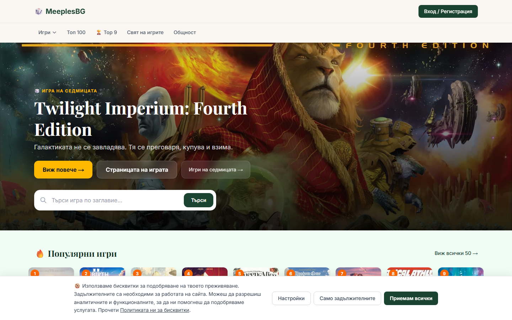
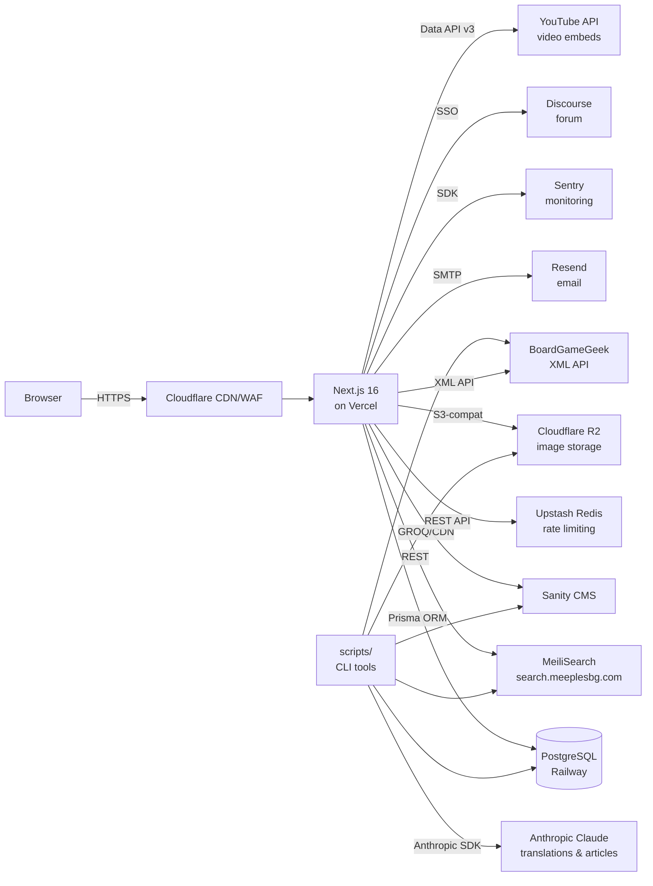

# MeeplesBG

> Най-голямата база данни с настолни игри на български език. | The largest Bulgarian-language board game database.

[](https://github.com/Lakata80/MeeplesBG/actions/workflows/ci.yml)
[](https://github.com/Lakata80/meeplesbg-e2e/actions)
[](https://meeplesbg.com)

<!-- TODO: add docs/screenshot.png -->
<!--  -->

MeeplesBG is a production board-game community site for Bulgarian players, built and operated solo. It provides a searchable catalogue of <!-- TODO: author to confirm --> board games with Bulgarian translations, user collections, wishlists, ratings, a community forum (Discourse SSO), a Top 9 monthly chart, news articles, and game image uploads.

## What this demonstrates

- **Full-stack production app run solo** — Next.js 16 App Router, React 19, PostgreSQL with Prisma, MeiliSearch, Sanity CMS, NextAuth v5, Resend, all deployed on Vercel and maintained in production.
- **Integration-heavy architecture** — eight external services wired together (database, search, CMS, auth, email, image storage, monitoring, forum SSO), with a strict Content Security Policy and Cloudflare in front.
- **Quality engineering** — separate E2E test repository ([meeplesbg-e2e](https://github.com/Lakata80/meeplesbg-e2e)) with Playwright Page Object Model against production; CI quality gate (type check + lint + secret scan); Sentry error monitoring; rate limiting on all mutation endpoints.
- **AI-assisted content pipeline** — Anthropic Claude API for Bulgarian translations of game descriptions and automated news articles, with homoglyph and mixed-script scanning as a quality check on AI output.
- **Operational tooling** — scripts for BGG data import, MeiliSearch re-indexing, category rank syncing, image upload to Cloudflare R2, and Sanity content management.

## Architecture



## Tech stack

| Layer | Technology | Version |
|-------|-----------|---------|
| Framework | Next.js (App Router) | 16.2.6 |
| UI | React | 19.2.4 |
| Language | TypeScript | ^5 |
| Styling | Tailwind CSS | ^4 |
| ORM | Prisma | ^5.22.0 |
| Database | PostgreSQL (Railway) | — |
| Search | MeiliSearch | ^0.58.0 |
| CMS | Sanity | ^13.1.0 (next-sanity) |
| Auth | NextAuth v5 | ^5.0.0-beta.31 |
| Email | Resend | ^6.12.4 |
| Rate limiting | Upstash Redis | ^1.38.0 |
| Image storage | Cloudflare R2 (AWS S3-compatible) | — |
| Monitoring | Sentry | ^10.62.0 |
| AI | Anthropic Claude (scripts only) | ^0.105.0 SDK |
| Hosting | Vercel | — |
| CDN/WAF | Cloudflare | — |
| Node.js | — | ≥22.0.0 |

## Quality & testing

- **E2E tests** — [`Lakata80/meeplesbg-e2e`](https://github.com/Lakata80/meeplesbg-e2e): Playwright with Page Object Model, running read-only tests against the production site on every push.
- **CI quality gate** — GitHub Actions runs `npm run typecheck` and `npm run lint` on every push and PR to `main`.
- **Secret scanning** — [gitleaks](https://github.com/gitleaks/gitleaks) runs on every PR via `.gitleaks.toml`.
- **Dependency updates** — Dependabot weekly updates for npm and GitHub Actions.
- **Sentry** — server-side and client-side error monitoring, with a `/monitoring` tunnel route to bypass ad-blockers.
- **Content Security Policy** — strict CSP on all routes via `next.config.js` headers, with a separate policy for the Sanity Studio path.
- **Rate limiting** — Upstash Redis rate limiting on all mutation API routes.

## Getting started

### Prerequisites

- Node.js ≥ 22
- A PostgreSQL database (local or [Railway](https://railway.app))
- Optional: MeiliSearch instance, Sanity project, Upstash Redis

### 1. Clone

```bash
git clone https://github.com/Lakata80/MeeplesBG.git
cd MeeplesBG
```

### 2. Install dependencies

```bash
npm ci
```

### 3. Configure environment variables

```bash
cp .env.example .env.local
```

Fill in the values in `.env.local`. See the [Environment variables](#environment-variables) table below.

**Required for local development:** `DATABASE_URL`, `NEXTAUTH_SECRET`, at least one OAuth provider (`GOOGLE_*` or `FACEBOOK_*`), `NEXT_PUBLIC_SITE_URL`.

**Optional for local development:** MeiliSearch, Sanity, Upstash Redis, Resend, Cloudflare R2, YouTube — the app degrades gracefully when these are absent.

### 4. Set up the database

```bash
# Apply all migrations
npx prisma migrate deploy

# (Optional) Open Prisma Studio
npx prisma studio
```

### 5. Start the development server

```bash
npm run dev
```

Open [http://localhost:3000](http://localhost:3000).

> **Note:** The production build (`npm run build`) is validated by Vercel preview deployments on every PR, because the build requires live connections to PostgreSQL, Sanity, and MeiliSearch for static page generation. It cannot be reproduced with placeholder values in CI.

## Environment variables

Copy `.env.example` to `.env.local` and fill in the values. The table below groups variables by whether they are required for the app to start.

### Required

| Variable | Description |
|----------|-------------|
| `DATABASE_URL` | PostgreSQL connection string |
| `NEXTAUTH_SECRET` | Random secret — generate with `openssl rand -hex 32` |
| `NEXTAUTH_URL` | Public URL of the app (`http://localhost:3000` for dev) |
| `GOOGLE_CLIENT_ID` | Google OAuth client ID |
| `GOOGLE_CLIENT_SECRET` | Google OAuth client secret |
| `NEXT_PUBLIC_SITE_URL` | Public URL of the site |
| `NEXT_PUBLIC_SANITY_PROJECT_ID` | Sanity project ID |
| `NEXT_PUBLIC_SANITY_DATASET` | Sanity dataset (usually `production`) |

### Optional (features degrade gracefully when absent)

| Variable | Description |
|----------|-------------|
| `FACEBOOK_CLIENT_ID` | Facebook OAuth client ID |
| `FACEBOOK_CLIENT_SECRET` | Facebook OAuth client secret |
| `SANITY_API_TOKEN` | Sanity write token (required for content mutations) |
| `SANITY_REVALIDATE_SECRET` | Webhook secret for Sanity on-demand revalidation |
| `MEILI_HOST` | MeiliSearch host URL |
| `MEILI_API_KEY` | MeiliSearch API key |
| `KV_REST_API_URL` | Upstash Redis REST API URL (rate limiting) |
| `KV_REST_API_TOKEN` | Upstash Redis REST API token |
| `CRON_SECRET` | Secret for cron endpoint authentication |
| `RESEND_API_KEY` | Resend API key (email) |
| `RESEND_FROM` | Default sender address |
| `RESEND_PARTNERS_FROM` | Partner email sender address |
| `YOUTUBE_API_KEY` | YouTube Data API v3 key (game video embeds) |
| `R2_ACCOUNT_ID` | Cloudflare account ID |
| `R2_ACCESS_KEY_ID` | Cloudflare R2 access key |
| `R2_SECRET_ACCESS_KEY` | Cloudflare R2 secret key |
| `R2_BUCKET_NAME` | R2 bucket name |
| `R2_PUBLIC_URL` | Public URL for R2 images |
| `ANTHROPIC_API_KEY` | Anthropic Claude API key (scripts only) |
| `BGG_SESSION_COOKIE` | BGG session cookie (mass import script only) |
| `BGG_DUMP_FILE` | Absolute path to a BGG data dump ZIP file |

## Project structure

```
MeeplesBG/
├── app/                # Next.js App Router
│   ├── (site)/         # Public routes (igri, novini, top, obshtnost, …)
│   ├── actions/        # Server Actions
│   ├── api/            # API route handlers
│   ├── legal/          # Legal pages (privacy, terms)
│   ├── login/          # Auth pages
│   └── studio/         # Sanity Studio (embedded)
├── components/         # React components
├── emails/             # React Email templates
├── lib/                # Shared utilities (prisma, search, sanity, auth, …)
├── prisma/             # Prisma schema and migrations
├── public/             # Static assets
├── sanity/             # Sanity schema definitions
├── scripts/            # Operational CLI scripts (see scripts/README.md)
│   └── one-off/        # Historical one-off scripts (excluded from tsc)
├── types/              # TypeScript type definitions
├── .github/
│   ├── workflows/ci.yml        # CI quality gate + secret scan
│   └── dependabot.yml          # Weekly dependency updates
└── .gitleaks.toml      # Gitleaks secret scanning configuration
```

## npm scripts

| Command | Description |
|---------|-------------|
| `npm run dev` | Start development server |
| `npm run build` | Generate Prisma client and build for production |
| `npm run start` | Start production server |
| `npm run typecheck` | Generate Prisma client and run `tsc --noEmit` |
| `npm run lint` | Run ESLint |
| `npm run hotness:sync` | Sync BGG hotness rankings to the database |
| `npm run import:games` | Import games from BGG dump file |
| `npm run import:bgg` | Fetch and import BGG data via API |
| `npm run import:reindex` | Re-index all games in MeiliSearch |
| `npm run translate` | Translate game descriptions via Anthropic Claude |
| `npm run upload:images` | Upload game images to Cloudflare R2 |
| `npm run import:mechanics` | Refresh game types and mechanics |
| `npm run partners:send` | Send partner inquiry email via Resend |
| `npm run write:article` | Generate a Sanity CMS article via Anthropic Claude |
| `npm run expansions:import` | Import game expansions from BGG |
| `npm run bgg:refresh-rank` | Refresh BGG rank data for all games |
| `npm run sync:ranks` | Sync category rank data |

See [scripts/README.md](scripts/README.md) for details on the operational scripts.

## Known limitations

- **No staging environment** — E2E tests run against production because there is no staging instance. Tests are read-only and do not mutate state.
- **Operational scripts run against live services** — the `scripts/` folder contains tooling that talks to the production database, MeiliSearch, Sanity, and Cloudflare R2. Use with care.
- **No unit tests** — the planned next step is to add unit tests for utility functions and server actions.

## Author

**Lazar Endarov** — QA / Quality Engineering Lead · [LinkedIn](https://www.linkedin.com/in/lazar-endarov-32b27b3a/)

## License

MIT © 2026 Lazar Endarov. See [LICENSE](LICENSE).
